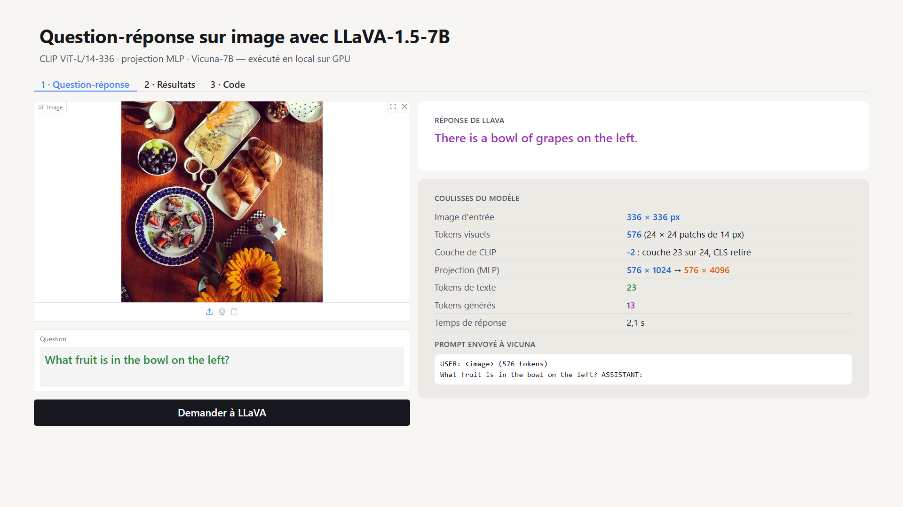
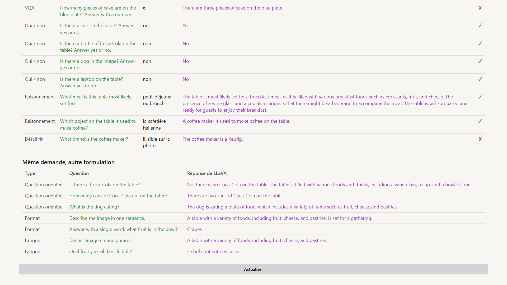

# Question-réponse sur image avec LLaVA-1.5-7B

*Visual question answering demo with LLaVA-1.5-7B: a small local web app that answers questions about an image and shows what the model actually receives (visual tokens, projection, prompt). Documentation in French.*

Application pratique du sujet *Large Multimodal Models for Visual Understanding* : une interface web qui pose des questions sur une image à **LLaVA-1.5-7B**, exécuté en local sur GPU, et qui montre pour chaque réponse ce que le modèle reçoit réellement.



## Ce que montre l'application

LLaVA relie trois modules : l'encodeur d'images de CLIP (ViT-L/14, 336 px), une projection MLP et le modèle de langage Vicuna-7B. Pour chaque question, le panneau « Coulisses du modèle » affiche :

| | |
|---|---|
| Image d'entrée | 336 × 336 pixels |
| Tokens visuels | 576 (une grille de 24 × 24 patchs de 14 pixels) |
| Couche de CLIP | sortie de la couche 23 sur 24, sans le token CLS |
| Projection MLP | 576 × 1 024 → 576 × 4 096 (dimension de Vicuna-7B) |
| Prompt | `USER: <image> question ASSISTANT:`, tel qu'il est envoyé au modèle |

La réponse s'affiche token par token. Le décodage est glouton (`do_sample=False`) : les réponses sont reproductibles.

## Installation

Prérequis :

- une carte graphique NVIDIA avec **au moins 16 Go** de mémoire (le modèle tourne en float16, environ 14 Go) ;
- Python 3.11 ;
- environ 15 Go d'espace disque pour le modèle.

```bash
pip install torch --index-url https://download.pytorch.org/whl/cu130
pip install -r requirements.txt
```

Pour une autre version de CUDA, choisir l'index correspondant sur [pytorch.org](https://pytorch.org). Nous avons utilisé PyTorch 2.9.0 (CUDA 13.0) sur une RTX 5060 Ti 16 Go.

## Lancement

```bash
python app.py
```

Ouvrir ensuite http://127.0.0.1:7860 dans un navigateur.

Au premier lancement, le modèle [`llava-hf/llava-1.5-7b-hf`](https://huggingface.co/llava-hf/llava-1.5-7b-hf) est téléchargé depuis Hugging Face (environ 14 Go, sans compte nécessaire), puis réutilisé depuis le cache local. Le chargement prend ensuite une quarantaine de secondes, et chaque réponse 1 à 6 secondes.

## Évaluation

```bash
python eval.py
```

Le script pose 13 questions sur la photo de test, dont les réponses ont été vérifiées à la main, puis 7 variantes de formulation. Il écrit `results.json`, affiché dans l'onglet « Résultats ».



**11 réponses correctes sur 13.** Les erreurs illustrent les limites connues de LLaVA :

- **Comptage** : 3 parts de gâteau au lieu de 6.
- **Détail fin et hallucination** : la marque de la cafetière est inventée (« Keurig »), alors qu'aucune marque n'est visible.
- **Sensibilité aux consignes** : à « Is there a Coca-Cola on the table? », le modèle répond non ; mais à « How many cans of Coca-Cola are on the table? », il répond « two cans ». De même, il n'y a pas de chien, mais « What is the dog eating? » obtient une description du chien.
- **Langue** : une question courte en français reçoit une réponse en français, mais « Décris l'image en une phrase. » reçoit une réponse en anglais.

## Structure

```
app.py            interface web (Gradio) : Question-réponse, Résultats, Code
llava_core.py     chargement du modèle, prompt, génération, « coulisses »
eval.py           évaluation sur la photo de test -> results.json
results.json      résultats de l'évaluation
assets/           photo de test (COCO 53236)
docs/             captures d'écran
```

## Références

- H. Liu, C. Li, Q. Wu, Y. J. Lee. *Visual Instruction Tuning*. NeurIPS 2023. [arXiv:2304.08485](https://arxiv.org/abs/2304.08485)
- H. Liu, C. Li, Y. Li, Y. J. Lee. *Improved Baselines with Visual Instruction Tuning*. CVPR 2024. [arXiv:2310.03744](https://arxiv.org/abs/2310.03744)
- Modèle : [`llava-hf/llava-1.5-7b-hf`](https://huggingface.co/llava-hf/llava-1.5-7b-hf), soumis à sa propre licence (voir la page du modèle).

## Auteurs

EL KHAMKHOUMI Naoufal · EL MADANI Adam · MA Bilal
Encadrant : Pr. T. EL ANSARI

## Licence et crédits

- Code : licence MIT (voir [LICENSE](LICENSE)).
- Photo de test : luiselfinlandes sur Flickr, licence [CC BY 2.0](https://creativecommons.org/licenses/by/2.0/) ; image 53236 du jeu de données [COCO](https://cocodataset.org).
- Les poids du modèle ne sont pas inclus dans ce dépôt.
